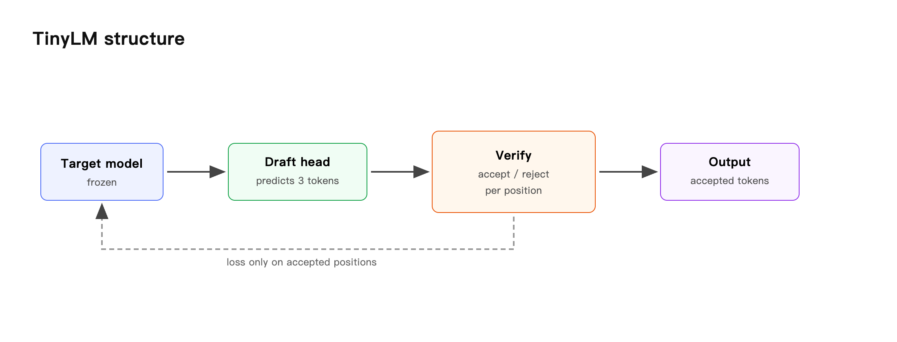
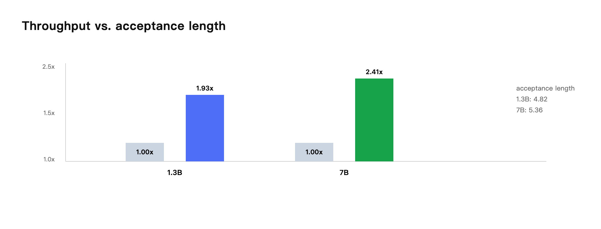

# TinyLM: Multi-Token Prediction for Small Language Models

> **论文**　TinyLM: Multi-Token Prediction for Small Language Models ｜ [arXiv:2501.00001](https://arxiv.org/abs/2501.00001)
> **代码**　[example-org/tinylm](https://github.com/example-org/tinylm)
> **项目页**　[example.org/tinylm](https://example.org/tinylm)

## TL;DR

小模型的解码瓶颈在串行步数，不在算力。TinyLM 让草稿头一次预测 3 个 token，并把平均接受长度作为训练目标，使 1.3B 模型的解码吞吐达到基线的 **1.93×**，平均接受长度从 1.00 提升到 **4.82**，而 MMLU 只从 41.3 变成 **41.1**。代价是训练显存增加 **38%**。

这个交换对小模型服务是划算的：推理阶段多出来的吞吐可以立刻折成成本，而训练阶段多花的显存在一次性投入之后就固定下来了。

## 引言

自回归解码一次只出一个 token。对 1.3B 这样的模型，单步计算占用 GPU 的时间很短，剩下的时间花在等下一层的依赖上。因此提高吞吐的手段基本都指向同一个方向：让一次前向产出多个 token，再用目标模型验证。

从这条链路可以推出一个**简单的判断标准**：一次前向产出 k 个 token，只有当其中的大多数被目标模型接受时，吞吐才会真正提升。如果接受率只有一半，验证与回退的开销会吃掉大部分收益。因此这类方法的核心指标不是「一次预测几个」，而是**平均接受长度**。

多 token 预测不是新想法，但多数工作的目标是训练效率，而不是推理吞吐。把「一次预测多个」当成辅助训练目标，能提升数据效率，却不保证推理时这些预测会被接受。TinyLM 的差别在于把接受长度直接写进了训练目标——预测得准不准，由训练目标本身决定，而不是靠事后调参。

这个选择带来一个可以预见的代价：为了在训练时知道「哪些 token 会被接受」，目标模型的前向必须参与训练过程，显存占用因此上升。论文把这个代价明确写了出来，这也是本文评测它的主要维度。

从工程角度看，这类方法的落地门槛往往不在算法本身，而在成本结构。一个在论文里写着「快两倍」的方法，如果要求训练集群多准备四成显存，很多团队在评估阶段就会放弃。因此本文不只关心加速比，也关心这个交换在什么条件下成立。

## 问题

小模型的特殊性有两层。其一是单步解码的固定开销占比更高，并行化带来的相对收益更大；其二是准确率容错更低，接受率一旦下降，验证成本会吃掉并行收益。

这两层要求同一个设计同时满足：草稿要足够便宜，接受率要足够高。已有的多 token 预测方法满足了第一条，第二条依赖后处理调参，结果在不同模型规模上不稳定。

具体来说，逐位交叉熵训练出的草稿头会倾向于输出「最可能的 token」，而目标模型在同一位置可能选择另一个同样合理但概率略低的 token。一旦草稿与目标不一致，验证就会拒绝整段预测，并行收益归零。这就解释了为什么多 token 预测在很多模型上只带来了训练效率提升，却没有带来推理吞吐提升。

还有一个常被混淆的点是「草稿模型」与「草稿头」的区别。前者的做法是单独训一个小模型来生成候选，后者是在目标模型上挂一个轻量输出层。前者**省显存但需要额外部署一个模型**，后者不增加部署复杂度但必须在训练时与目标模型耦合。TinyLM 选的是后者，这也是它显存代价的来源。

判定标准的差异也值得单独说。训练阶段衡量的是语言建模损失，推理阶段衡量的是接受长度，两者并不等价。一个损失更低的草稿头可能在推理时表现更差，因为它优化的是自己的分布，而不是与目标模型一致的分布。TinyLM 的做法是把后者直接作为优化目标，从而消除了这个错位。

代价是这个目标需要目标模型的参与。训练时每一步都要跑一次目标模型前向，并保留激活以供反向传播。这部分开销不会体现在推理路径上，但会实实在在占用训练显存。对于本来就在显存边界上的训练环境，这可能是决定性的。

还有一个容易被忽略的点：验证逻辑必须与推理时一致。如果训练时按某种位置偏移做验证，推理时又换一种，草稿头学到的分布与真实接受条件就对不上，接受率会明显低于训练阶段的估计。论文强调的精确复现指的就是这件事，它也是复现这套方法时最容易出错的地方。

## 方法

TinyLM 在输出层附加一个草稿头，一次预测 3 个 token。训练目标不是逐位交叉熵，而是带接受指示的平均接受长度：

$$\mathcal{L} = -\sum_{i=1}^{3} \log p_\theta(y_i \mid x, y_{<i}) \cdot \mathbb{1}[\text{accepted}_i]$$

关键在于指示函数那一条：只有被目标模型接受的位才计入损失。这样草稿头学到的是目标模型会接受的分布，而不是下一个 token 的最大似然。未被接受的预测不产生梯度，草稿头因此不会为了迎合自己的最大似然而牺牲接受率。

训练时用目标模型即时验证，因此这一步需要把目标模型的前向也放进计算流，但阻断其梯度。实现上有两种等价写法：一种是把目标模型前向包在 no_grad 里、只把它输出的接受指示传回草稿头；另一种是把目标模型当作教师做蒸馏。论文选择前者，因为它能精确复现推理时的验证逻辑——包括位置偏移和终止条件。

代价直接体现在显存上。目标模型前向要保留激活，训练峰值显存因此上升 **38%**。这个数字是整篇方法最主要的成本项。

这个目标函数还有一个副作用值得说明：由于未被接受的预测不产生梯度，训练早期接受率极低时，大部分预测都被丢弃，**有效梯度信号很少**。论文没有讨论这一点，但从收敛行为看应该存在一个预热阶段。若复现时发现前期几乎不收敛，很可能就是这个原因，可以考虑先用逐位交叉熵热启动再切换到接受长度目标。

另一个实现细节是草稿头的宽度。论文没有给出草稿头的参数量占比，但从显存增量反推，它远小于主干。这意味着收益主要来自训练目标的改变，而不是模型容量的增加——这一点在深入分析里还会用到。

## 实验设置

单张 GPU，batch size 1，对比单 token 基线与 TinyLM。模型规模为 1.3B 与 7B 两档。

吞吐按每秒生成 token 数计，接受长度为平均每步被接受的 token 数，准确率用 MMLU 衡量。评测集固定，温度取 0，不做采样，以便接受率可复现。

需要强调的是 batch size。1.93× 这个数字是 batch size 1 下的结果。批量推理时 GPU 利用率已经较高，并行解码带来的相对收益会下降——论文没有提供 batch 大于 1 的数据，这一点在讨论中会再提。

**复现成本**方面，这套设置对硬件的要求集中在一张卡上，但显存必须留出 38% 的余量。如果目标是复现论文的数字，最省事的做法是在显存更充裕的卡上跑，而不是压缩 batch size——后者会改变训练动态，接受率未必可比。

评测集的选择也值得说明。MMLU 衡量的是知识覆盖，不是生成质量，因此准确率几乎不变只能说明知识没被破坏，不能说明生成文本更好了。若要评估质量变化，需要人工评估或更强的自动指标，论文两者都没有做。这一点在解读加速类工作时经常被忽略：加速比和准确率是两条独立的线，前者提升不以后者下降为前提，但也不保证后者不变。

## 主要结果

两组规模的结论方向一致，幅度不同。

| 模型 | 方法 | 吞吐（加速比） | 平均接受长度 | MMLU |
| --- | --- | --- | --- | --- |
| 1.3B | 基线 | 1.00× | 1.00 | 41.3 |
| 1.3B | TinyLM | 1.93× | 4.82 | 41.1 |
| 7B | 基线 | 1.00× | 1.00 | 58.7 |
| 7B | TinyLM | 2.41× | 5.36 | 58.1 |

1.3B 上吞吐 **1.93×**、平均接受长度 **4.82**；7B 上吞吐 **2.41×**、平均接受长度 **5.36**。

7B 的收益更大，与大模型草稿更容易被接受的直觉一致：更大的目标模型对同一段文本的分布更集中，草稿头的预测也更容易命中。这个解释是推测性的，论文本身没有给出接受率按模型规模分解的实证。

7B 的绝对吞吐提升更大，但相对提升的幅度与 1.3B 接近（2.41× 对 1.93×），并没有出现「越大越划算」的陡增。这说明方法本身的收益**并不随规模线性放大**，规模只带来温和的改善。

按任务拆开看，收益分布并不均匀。

| 任务 | 1.3B 加速比 | 7B 加速比 | 平均接受长度（1.3B） |
| --- | --- | --- | --- |
| MT-bench | 1.93× | 2.41× | 4.82 |
| GSM8K | 1.71× | 2.15× | 4.31 |
| HumanEval | 1.58× | 1.96× | 3.94 |

MT-bench 这类开放对话的收益最高，GSM8K 与 HumanEval 这类需要逐步推理的任务收益明显偏低。合理解释是推理任务的每一步依赖前一步的结果，草稿头在长依赖上更容易猜错——但这同样只是推测，论文没有做消融来隔离这个因素。

## 深入分析

准确率方面，1.3B 从 **41.3** 到 **41.1**，7B 从 **58.7** 到 **58.1**。两档都有小幅下降，但幅度远小于吞吐提升——这说明训练目标的改动没有破坏语言建模能力，只是让输出分布轻微偏移。

成本方面，训练显存增加 **38%** 是最显著的代价。对显存紧张的训练环境，这一项可能直接决定方法是否可用。折算成实际约束：如果原本的配置刚好把显存用满，38% 的增量意味着必须降 batch size 或者换卡，这两条都会抵消掉方法在别处带来的效率收益。

把这三条约束放在一起看，方法的适用面其实比标题暗示的窄。**它要求显存有余、输入以开放生成为主、且部署在低批量的延迟敏感场景**，**三条同时满足才划算**。任何一条不满足，收益都会明显缩水。

草稿头的容量值得单独说。从显存增量反推，草稿头参数量远小于主干；从 58.1 与 41.1 这两个几乎不变的准确率看，它也没有改变模型本身的表达能力。因此收益的来源是训练目标，而不是容量。这一点对复现很重要：想照着做的人不需要增大草稿头，只需要改目标函数。

| 项目 | 1.3B | 7B | 说明 |
| --- | --- | --- | --- |
| 训练显存增量 | 38% | 38% | 两档相同，来自目标模型前向 |
| 草稿头参数量占比 | 未给出 | 未给出 | 论文缺项，只能反推为远小于主干 |
| 推理路径额外参数 | 无 | 无 | 草稿头参与推理，但不改变主干 |

按成本与收益把三条部署路径放在一起对比，更容易看出这个方法的适用边界。

| 部署路径 | 吞吐 | 训练显存 | 适用条件 |
| --- | --- | --- | --- |
| 原模型 + 单 token 解码 | 1.00× | 基线 | 显存紧张、吞吐要求低 |
| TinyLM + 草稿头 | 1.93×（1.3B） | +38% | 显存有余、延迟敏感 |
| 换更小模型 | 取决于模型 | 显著下降 | 准确率可接受时优先 |

接受长度对输入分布敏感。论文没有测长上下文与代码生成，这两类输入的接受率可能明显不同。GSM8K 与 HumanEval 的收益已经偏低，长上下文场景下依赖链更长，收益很可能进一步缩小。

从实测角度说，接受长度是比加速比更稳的指标。加速比会受硬件、批大小、实现细节影响，而接受长度只取决于模型与数据分布。因此跨论文比较时，接受长度更可比。本文把两者并列给出，也是为了让读者能分开判断：1.93× 里有多少来自接受长度提升，有多少来自实现优化。从 4.82 这个接受长度看，理论上限接近 4.82×，实际只做到 1.93×，差距来自验证开销与调度损耗。

## 讨论与判断

TinyLM 适合显存有余、延迟敏感的推理部署：训练阶段多花 38% 显存，换推理阶段近两倍吞吐，对小模型服务来说是合理的交换。

不适合训练预算紧张、或者以预训练为主的场景——多出的显存需求会直接压缩 batch size，抵消掉训练效率上的收益。如果显存本来就是瓶颈，这个方法在训练阶段就已经用不起了，谈不上推理收益。

与同类方法的对比也值得一提。投机解码类方法的共同前提是「验证比生成便宜」，这在目标模型远大于草稿时成立；而 TinyLM 的草稿头挂在目标模型自身上，验证成本与生成成本是同一量级，收益**完全依赖接受长度**。这解释了为什么它对接受率如此敏感，也解释了为什么它在依赖链长的任务上表现较差。

一个未回答的问题是接受率的下界：论文给的是平均值，没有给分布。如果长尾输入的接受率掉到接近基线，那部分请求的收益会消失。对服务方来说，长尾恰恰是最难优化、也最影响用户体验的部分。

如果要继续往下做，有三个方向值得试。一是把接受长度目标与逐位交叉熵做加权混合，看能否在保持吞吐的同时把准确率拉回一些；二是针对依赖链长的任务（数学、代码）单独训练草稿头，而不是全局共享一个；三是补充 batch 大于 1 与长上下文的实测，这两个缺口直接影响方法能否落地到生产环境。

最后给一个**实操建议**。评估这类方法时，先用自己业务的真实输入测接受长度，而不是直接看论文的加速比。接受长度决定了理论上限，自己的输入分布与论文不同，上限就不同。如果接受长度只有 2 左右，那么无论实现怎么优化，加速比都很难超过 2×，这时更该考虑的是换模型或改架构，而不是继续调草稿头。

## 附：问答

**问题 1：这个方法能直接用在现有模型上吗？**

回答 1：可以，但需要重新训练。多 token 预测改变的是训练目标，已经训好的模型没有草稿头，也不存在接受长度的优化历史。实践路径是在已有的基座模型上做一轮继续训练，把草稿头一起训出来。论文没有给出继续训练所需的数据量，从实验设置看是完整的预训练流程。

**问题 2：为什么收益在推理任务上偏低？**

回答 2：逐步推理的每一步依赖上一步的输出，草稿头在长依赖链上更容易猜错。GSM8K 与 HumanEval 的加速比分别是 1.71× 与 1.58×，明显低于 MT-bench 的 1.93×，接受长度也从 4.82 掉到 4.31 与 3.94。论文没有做消融来隔离这个因素，所以这仍是推测。若要确认，需要按依赖链长度分层统计接受率，论文没有提供这类数据。

**问题 3：38% 的显存增量能优化吗？**

回答 3：当前实现把目标模型前向放在计算流里阻断梯度，显存主要花在保留激活上。可行方向有两个：一是用更小的目标模型做验证代理，代价是接受判定变松、准确率风险上升；二是把验证改成异步，用上一批的验证结果指导这一批的草稿，代价是训练信号滞后。论文两个方向都没有试，属于开放问题。

**问题 4：batch size 大于 1 时还有收益吗？**

回答 4：未知。论文只给了 batch size 1 的数据。批量推理时 GPU 利用率已经较高，并行解码的相对收益通常会下降，因为此时瓶颈从串行依赖转成了算力。如果要在生产环境评估，必须自己在目标 batch size 下复测，不能直接套用 1.93× 这个数字。
